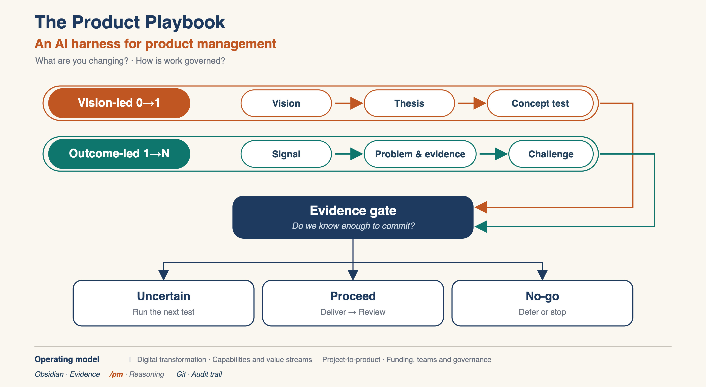

# Visual Standards

> [!NOTE] For humans and agents
> This is the shared design contract: humans approve it, agents extend it through the generator. It is not an onboarding page.

Approved canonical visual language for the PM Playbook.

## What the visual must convey

At a glance, the viewer should understand:

- There are two legitimate ways to start product work: from a future thesis, or from observed signal.
- Both paths converge on the same evidence question: **Do we know enough to commit?**
- Evidence leads to one of three honest outcomes: run the next test, proceed to delivery and review, or stop/defer.
- The harness and operating model sit underneath the work as support conditions, not as extra steps in the main flow.

## Locked design conventions

1. **Two compact token-pill rows**
   - Vision-led 0→1: Vision → Thesis → Concept test, copper.
   - Outcome-led 1→N: Signal → Problem & evidence → Challenge, teal.
   - Both sit in slim outline containers.

2. **One shared Evidence-gate box**
   - Navy.
   - Text: “Do we know enough to commit?”
   - Both rows feed it from the right margin.

3. **One fan-out to three outcome cards**
   - Uncertain → Run the next test.
   - Proceed → Deliver → Review.
   - No-go → Defer or stop.

4. **Demoted footer strip**
   - Harness: Obsidian · Evidence, /pm · Reasoning, Git · Audit trail.
   - Operating model: Digital transformation vs Project-to-product.

## Discipline

- Maximum ~12 elements.
- All text stays inside containers.
- Nothing floats.
- No crossing lines.
- If a future graphic needs more detail, extend the footer. Do not add elements to the main flow.

## Assets

| File | Role |
|---|---|
| `Visuals/playbook_v8.png` | Approved render |
| `Visuals/playbook_v8.svg` | Editable source |
| `Visuals/playbook_min_source.svg` | Build-name source |
| `Visuals/build_infographic_min.py` | Deterministic SVG generator |

## Variation rules

- Treat the approved visual as locked.
- Generate future variants — decks, one-pagers, per-playbook graphics — by changing the generator tokens, not by redrawing the composition.
- Keep the same hierarchy: two starting paths → shared evidence gate → three outcomes → demoted footer.
- Do not add main-flow elements to carry extra explanation. Put additional detail in the footer or a separate supporting graphic.
