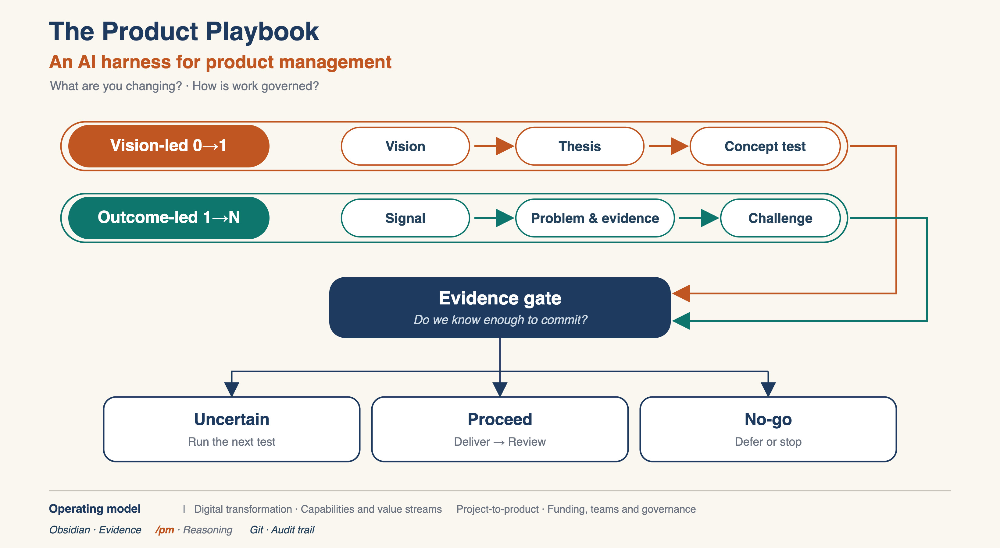

# PM Playbook

**Version:** 0.1.0 · [Changelog](CHANGELOG.md) · [Versioning](VERSIONING.md)

> [!NOTE] For humans
> This is the human entry point: where to start, which playbook to choose, and where artifacts go. Agents start at [PM](99-Playbook/PM.md) and [Rules](99-Playbook/Rules.md); technical setup is in [Architecture](99-Playbook/Architecture.md).

**Obsidian is the workspace. `/pm` is the reasoning layer. Git is the audit trail.**

This playbook supports four ways of working, but they answer different questions:

- **Product lifecycle:** are we creating a new product, or improving an existing one?
- **Operating model:** are we changing a product, a portfolio, or how the organization funds and staffs product work?



The canonical discovery-to-delivery chain and its transition gates are in
[Discovery to Delivery](99-Playbook/Discovery-to-Delivery.md).

The harness will not invent evidence, silently rewrite strategy, or produce a solution brief before
validation. Empty fields and `Evidence unavailable.` are preferable to plausible fiction.

## Platform and vault layout

The maintainer runs this on macOS with iCloud, but the harness is not tied to either. It is Markdown
files plus an Obsidian vault.

| Layout | Obsidian vault root | Standard Dashboard |
|---|---|---|
| Nested (default) | Parent folder containing `PM vault` | works as-is |
| Repository root | The `PM vault` folder itself | works as-is |
| Renamed nested | Parent folder containing the renamed folder | works as-is |

On Windows or Linux, clone or copy the repository anywhere and open the chosen folder in Obsidian.
The Dashboard uses `FROM ""` and type filters, so it does not need a folder prefix. Custom
folder-scoped queries can use a prefix, but the standard tables do not. A fresh clone uses a normal
`.git` directory; the external git pointer is the maintainer's macOS/iCloud setup only.

## Start in five minutes

1. Open the folder that contains the harness in Obsidian. Any local or synced folder works.
2. Enable **Dataview** in that vault: Settings → Community plugins.
3. Open **[Dashboard](Dashboard.md)**. Empty tables are normal before any artifacts exist.
4. Choose one playbook below and follow its flow.

No paid Obsidian features or GitHub account are required.

## Agent layer

The `/pm` commands are a separate agent layer, not part of the vault. The vault renders without
them. `/pm` is the `pm` skill, so the desktop and the classic CLI expose one command, not two.

- Source: [`agent/`](agent/README.md)
- Skill: `$HERMES_HOME/skills/productivity/pm/`
- Smoke test: `/pm status`
- Expected result: product health, the top problems and opportunities, and one recommended next action

If the skill is missing, the vault still works; only the command layer is unavailable.

A fresh clone includes the source in `agent/`, but it is not loaded until you install it. Run:

```bash
python3 -m pip install -r scripts/requirements.txt
python3 scripts/install_agent_layer.py --vault . --hermes-home "$HERMES_HOME"
```

Then test `/pm status`. See https://hermes-agent.nousresearch.com/docs/.

## Validate

```bash
python3 -m pip install -r scripts/requirements.txt
python3 scripts/validate_vault.py
```

The validator checks relative Markdown links and anchors, frontmatter, ID uniqueness, filename/ID
consistency, and product-template fill markers. It runs in CI on every push and pull request.

Full setup and operating guide: [Agent-Manual](99-Playbook/Agent-Manual.md). Guided lab:
[Agent Walkthrough](99-Playbook/Agent-Walkthrough.md). Value estimate:
[Harness Value](99-Playbook/Harness-Value.md).

## Choose your playbook

Ask two questions:

1. **What are you changing?** A product, a portfolio, or the operating model.
2. **How is work governed?** Project funding or durable product teams.

| What you are changing | Product-model governance | Project-model governance |
|---|---|---|
| New product or new market | [Vision-Led-0-to-1](99-Playbook/Playbooks/Vision-Led-0-to-1.md) | [Project-to-Product](99-Playbook/Playbooks/Project-to-Product.md) first, then [Vision-Led-0-to-1](99-Playbook/Playbooks/Vision-Led-0-to-1.md) |
| Existing product | [Outcome-Led-1-to-N](99-Playbook/Playbooks/Outcome-Led-1-to-N.md) | [Project-to-Product](99-Playbook/Playbooks/Project-to-Product.md) first, then [Outcome-Led-1-to-N](99-Playbook/Playbooks/Outcome-Led-1-to-N.md) |
| Portfolio or enterprise capability | [Digital-Transformation](99-Playbook/Playbooks/Digital-Transformation.md) | [Project-to-Product](99-Playbook/Playbooks/Project-to-Product.md) + [Digital-Transformation](99-Playbook/Playbooks/Digital-Transformation.md) |

These are not four stages of one loop. **Vision-led** and **outcome-led** are product-lifecycle
paths. **Digital transformation** and **project-to-product** are operating-model transitions that
change funding, team topology, governance, and metrics before product discovery can run cleanly.

If you are unsure, start with the product-lifecycle question. Use project-to-product only when
funding or team structure blocks durable product work.

## Compliance rail

Every playbook runs with a Tier 1 health-data compliance rail. Before handling PII, PHI, ePHI, or
vendor data, start with the live [Compliance Scope](11-Compliance/COMP-003-Compliance-Scope.md). If its status is
`draft` or its owner is `Unassigned`, stop and complete it before handling data.

Compliance is not a fifth loop. It is a constraint that can stop or reshape any stage. Tier 2 —
ISO 13485, ISO 14971, IEC 62304, and device QMS — applies only when the product is a medical device
or SaMD.

## The two product loops

### Vision-led 0→1

Use when the product or market does not exist yet, or when the team is entering a new segment with a
new value proposition.

| Stage | Question | Artifact |
|---|---|---|
| Vision | What future are we trying to create? | [Product Vision Board](99-Playbook/Templates/Product-Vision-Board.md) |
| Target group and need | Who is it for, and what job are they trying to do? | [Persona](99-Playbook/Templates/PERSONA-001-HDHP-Imaging-Patient.md) · [JTBD](99-Playbook/Templates/JTBD-001-Know-Cost-Before-Booking.md) |
| Why now / why us | What changed, and why are we the ones to win? | [Strategy](99-Playbook/Templates/Strategy.md) |
| Goals and North Star | What outcome proves the thesis? | [Goals](99-Playbook/Templates/Goals.md) · [Metrics](99-Playbook/Templates/Metrics.md) |
| Opportunity map | Which customer problems matter most? | [Problem](99-Playbook/Templates/PROB-001-Imaging-Cost-Problem.md) · [Opportunity](99-Playbook/Templates/OPP-001-Outpatient-Imaging-Cost.md) · [Discovery Map](99-Playbook/Templates/Discovery-Map.md) |
| What would have to be true | Which assumptions carry the thesis? | [Opportunity four risks](99-Playbook/Templates/OPP-001-Outpatient-Imaging-Cost.md#the-four-big-risks) · [Decision](99-Playbook/Templates/DEC-001-Build-Partner-Defer.md) |
| Concept tests | What is the cheapest evidence that changes the bet? | [Experiment](99-Playbook/Templates/EXP-001-Comprehension-Test.md) |
| MVP | What is the smallest coherent product that tests the thesis? | [PRD](99-Playbook/Templates/PRD-001-Imaging-Estimate.md) |
| Launch and review | Did the world change, and what did we learn? | [Release](99-Playbook/Templates/REL-001-Imaging-Estimate-Pilot.md) · [Review](99-Playbook/Templates/REVIEW-2027-02-Imaging-Estimate-Pilot.md) |

**Entry artifact:** [Product Vision Board](99-Playbook/Templates/Product-Vision-Board.md)

**Gate:** a PRD is produced only after the riskiest assumptions have concept-test evidence.

**Full playbook:** [Vision-Led-0-to-1](99-Playbook/Playbooks/Vision-Led-0-to-1.md)

### Outcome-led 1→N

Use when the product already exists and the work is to improve an outcome, respond to customer
signal, or decide what to build next.

| Stage | Question | Artifact / next step |
|---|---|---|
| Signal | What did we observe, and from whom? | [Feedback](99-Playbook/Templates/FB-001-Imaging-Cost-Feedback.md) · [Research](99-Playbook/Templates/RESEARCH-001-Imaging-Cost-Transparency.md) |
| Problem | Who experiences what problem, when, and at what cost? | [Problem](99-Playbook/Templates/PROB-001-Imaging-Cost-Problem.md) |
| Evidence | What supports or contradicts the problem? | Research, data, or `Evidence unavailable.` |
| Opportunity | Is this worth pursuing, and what are the four risks? | [Opportunity](99-Playbook/Templates/OPP-001-Outpatient-Imaging-Cost.md) |
| Challenge | What would make this a no-go or defer? | [Opportunity challenge](99-Playbook/Templates/OPP-001-Outpatient-Imaging-Cost.md#adversarial-challenge) |
| Uncertain | What is the cheapest test that retires the primary risk? | [Experiment](99-Playbook/Templates/EXP-001-Comprehension-Test.md) → revise Opportunity |
| Sufficient evidence | What are we choosing, and why? | [Decision](99-Playbook/Templates/DEC-001-Build-Partner-Defer.md) |
| Solution brief | What is the smallest coherent solution? | [PRD](99-Playbook/Templates/PRD-001-Imaging-Estimate.md) |
| Delivery | What shipped, and what moved? | [Release](99-Playbook/Templates/REL-001-Imaging-Estimate-Pilot.md) |
| Review | What did we learn, and what risk remains? | [Review](99-Playbook/Templates/REVIEW-2027-02-Imaging-Estimate-Pilot.md) |

**Entry artifact:** [Feedback](99-Playbook/Templates/FB-001-Imaging-Cost-Feedback.md) or a
Problem note.

**Gate:** a solution brief is written only after the opportunity has evidence, a challenge, and a
defined metric baseline.

**Full playbook:** [Outcome-Led-1-to-N](99-Playbook/Playbooks/Outcome-Led-1-to-N.md)

Both loops use the same artifacts. The difference is the entry point and the evidence gate.

## Operating-model transitions

These are not product lifecycle stages. They change the conditions under which product work happens.

| Transition | Use when | First artifact | Playbook |
|---|---|---|---|
| Digital transformation | The unit of change is a portfolio or enterprise capability | Transformation thesis and capability map | [Digital-Transformation](99-Playbook/Playbooks/Digital-Transformation.md) |
| Project-to-product | Project funding, team topology, or governance blocks durable product teams | Product taxonomy and flow baseline | [Project-to-Product](99-Playbook/Playbooks/Project-to-Product.md) |

## Two linked views

Both loops keep the reasoning visible through the same two views:

- **[Discovery Map](03-Opportunities/Discovery%20Map.md)** — outcome → problems → opportunities → alternative solutions → experiments
- **[Goals](00-Product/Goals.md)** — Objective and Key Results plus goal → actor → behaviour change → deliverable

## Commands

| Command | Use when | Produces |
|---|---|---|
| `/pm status` | You want current health and one next action | Read-only summary |
| `/pm discover <area>` | You need candidate problems | Research/problem notes and OST links |
| `/pm analyze OPP-001` | You need evidence, impact, alternatives and risks | Opportunity analysis |
| `/pm challenge OPP-001` | You want adversarial review | Objections, no-go/defer options, cheapest test |
| `/pm prd OPP-001` | Validation has passed | Solution brief — or a refusal explaining the gate |
| `/pm decide <question>` | A significant choice must be recorded | Proposed decision record |
| `/pm review` | You want vault-quality findings | Stale, orphaned, unsupported and map-integrity findings |

Replace `OPP-001` with the actual ID of your note.

## Where information goes

| Information | Destination |
|---|---|
| Vision, target group and needs | `00-Product/Product.md` |
| Strategy, differentiation and why now / why us | `00-Product/Strategy.md` |
| Objective, Key Results and Impact Map | `00-Product/Goals.md` |
| Primary coverage metric, outcome metric, inputs and guardrails | `00-Product/Metrics.md` |
| Transformation thesis, capability map, value stream, adoption scorecard, portfolio roadmap | `09-Transformation` |
| Product taxonomy, funding model, team topology, flow baseline, dependency map, transition roadmap | `10-Operating-Model` |
| Compliance scope, data inventory, risk assessment, control matrix, vendor/BAA register, incident response, compliance review | `11-Compliance` |
| Persona, JTBD, or journey map | `01-Users` |
| Verbatim customer complaint | `01-Users/Feedback` |
| Interview synthesis | `04-Research/Users` |
| Market sizing or regulatory change | `04-Research/Market` |
| Competitor or workaround analysis | `04-Research/Competitors` |
| Metric, query or baseline | `04-Research/Data` |
| Evidence-backed user pain | `02-Problems` |
| Proposed opportunity and risk assessment | `03-Opportunities` |
| Outcome-to-experiment relationships | `03-Opportunities/Discovery Map.md` |
| Feature idea without a problem | Park it; convert it to a problem before delivery |
| Significant choice between options | `05-Decisions` |
| Riskiest assumption test | `07-Delivery/Experiments` |
| Validated solution brief | `07-Delivery/PRDs` |
| Shipped outcome | `07-Delivery/Releases` |
| Monthly learning and mistakes | `08-Reviews` |

Templates live in `99-Playbook/Templates/`; the index is [_Templates](99-Playbook/Templates/_Templates.md).

## Creating notes correctly

- Copy the template's **frontmatter verbatim**, then fill the values.
- Never change `type:`; Dataview uses it to route notes into tables.
- Allocate the next ID from the highest existing ID in that folder.
- Link canonical artifacts with relative Markdown links that resolve in both Obsidian and GitHub; do not duplicate their contents.
- Templates carry an illustrative example. Replace it with your own evidence before using the note for real work.
- Leave unknowns as `unknown`; do not invent baselines, quotes, dates or market figures.
- Update `updated:` whenever the note materially changes.

## Dashboard and troubleshooting

| Symptom | Meaning | Action |
|---|---|---|
| Grey query blocks | Dataview is not loading | Enable it in the vault that contains the harness |
| Empty tables | Usually no artifacts yet | Add one correctly typed note |
| Note missing from a table | Wrong `type` or Dataview not enabled | Check frontmatter; run `python3 scripts/validate_vault.py` |
| Blank column | Frontmatter key missing | Copy the template schema |
| New note not immediately visible | Obsidian index lag | Wait a few seconds |
| Stale item shown | Frontmatter `updated:` is old | Review and update the artifact |
| Git behaves unexpectedly | `.git` is a pointer file | This is the maintainer's external-git setup; do not move git internals into a synced folder |

## Operating cadence

**Vision-led**

- **Monthly:** review the vision, target group, why now / why us, and the riskiest assumptions.
- **Before build:** require concept-test evidence and a decision record.
- **Quarterly:** compare the current bet with the original thesis.

**Outcome-led**

- **As signal arrives:** capture Feedback, Research and Problems.
- **Weekly:** `/pm status`; challenge the leading opportunity; review experiments.
- **Before committing:** opportunity assessment, alternative solutions, evidence and decision record.
- **After shipping:** Release note with metric movement and surprises.
- **Monthly:** `/pm review` plus a Review note covering goals, risks and mistakes.

## Permissions and privacy

Research, problems, opportunities, experiments and reviews are agent-writable. PRDs and roadmap
changes are drafts. Product strategy and accepted decisions require human approval; see [Rules](99-Playbook/Rules.md).

Customer quotes and account names can be sensitive. Remove unnecessary personal information before
putting feedback into a shared or synced vault.

## Learn more

- **[_Playbooks](99-Playbook/Playbooks/_Playbooks.md)** — the four playbooks and when to use each
- **[Visual-Standards](99-Playbook/Visual-Standards.md)** — approved canonical visual language
- **[_Operating-Models](99-Playbook/Templates/Operating-Models/_Operating-Models.md)** — the operating-model template set
- **[_Compliance](11-Compliance/_Compliance.md)** — Tier 1 compliance rail
- **[_Compliance-Templates](99-Playbook/Templates/Compliance/_Compliance-Templates.md)** — compliance template set
- **[Vision-Led-0-to-1](99-Playbook/Playbooks/Vision-Led-0-to-1.md)** — new product or new market
- **[Outcome-Led-1-to-N](99-Playbook/Playbooks/Outcome-Led-1-to-N.md)** — existing product
- **[Digital-Transformation](99-Playbook/Playbooks/Digital-Transformation.md)** — portfolio or enterprise capability change
- **[Project-to-Product](99-Playbook/Playbooks/Project-to-Product.md)** — funding, team topology, and governance transition
- **[START-HERE](START-HERE.md)** — first guided workflow for the outcome-led path
- **[Worked vertical slice](examples/vertical-slice/README.md)** — synthetic chain from product to review
- **[Architecture](99-Playbook/Architecture.md)** — folder mode, frontmatter, query paths, git and agent write boundaries

## License

MIT for scripts, the agent layer, and original documentation. Pichler-derived template sections are
CC BY-SA 4.0. See [LICENSE](LICENSE) and [NOTICE](NOTICE).
